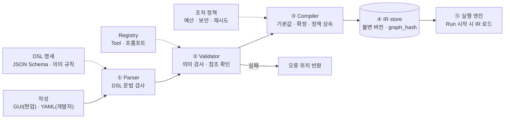

# 4. Workflow 정의: DSL → IR

> 무거운 검증과 확정은 배포 전에 끝내고, 실행 엔진은 확정된 IR만 받는다

## 용어

| 용어 | 풀이 | 비유 (Java) | 누가 만드나 |
|---|---|---|---|
| DSL | Domain-Specific Language: 문법·의미 **규칙** | 언어 명세 | 프레임워크 설계자 (1회) |
| YAML | DSL로 쓴 **문서** | `.java` 소스 | 워크플로 설계자 |
| IR | Intermediate Representation: 실행용 **확정본** | `.class` 바이트코드 | Compiler 자동 생성 |

## 컴파일 파이프라인



## Validator 의미 검사 항목
- 참조한 Tool · 프롬프트가 Registry에 존재하는가
- 노드가 읽는 필드(reads)를 앞선 노드가 써주는가(writes)
- 탈출 조건 없는 루프가 없는가
- 병렬 노드가 같은 필드를 쓰면 병합 규칙(reducer)이 있는가
- 조건식 문법 (안전한 표현식 언어: CEL / JSONata, `eval` 금지)

## YAML (사람이 작성)

```yaml
dsl: "1.0"
workflow: incident-response
version: 3
state: {alert: string, root_cause: string, fix_plan: string}
nodes:
  - id: analyze
    type: agent
    prompt: root-cause@v2
    tools: [log.read]
    reads: [alert]
    writes: [root_cause, fix_plan]
  - id: approve
    type: human
    assignee: {role: ops_lead}
    show: [root_cause, fix_plan]
    timeout: 4h
  - id: apply
    type: task
    connector: ops.execute_runbook
    reads: [fix_plan]
edges:
  - analyze -> approve -> apply
```

## IR (컴파일러가 생성, 발췌)

```json
{
  "graph_hash": "sha256:9f3c...",
  "nodes": {
    "analyze": {
      "kind": "agent", "max_iter": 5,
      "prompt": {"name": "root-cause", "version": 2, "hash": "sha256:a1b2..."},
      "tools": [{"id": "log.read", "side_effect": "read", "approval": false}],
      "budget": {"max_tokens": 20000}
    },
    "approve": {
      "kind": "human", "timeout_sec": 14400,
      "on_timeout": {"action": "escalate", "to": {"role": "ops_manager"}},
      "writes": ["approval"]
    },
    "apply": {
      "kind": "task",
      "connector": {"id": "ops.execute_runbook", "side_effect": "write", "auth_ref": "vault://ops/sa"},
      "idempotency_key": "{run_id}-apply"
    }
  },
  "edges": [
    {"from": "approve", "to": "apply", "condition": "approval.decision == 'approve'"},
    {"from": "approve", "to": "__end__", "condition": "approval.decision == 'reject'", "end_status": "rejected"}
  ]
}
```

## 컴파일러가 확정하는 다섯 가지

| # | 항목 | 예 |
|---|---|---|
| ① | 기본값 채움 | max_iter, model, retry |
| ② | 참조 확정 | 프롬프트 이름@버전 → 내용 해시, Tool 이름 → Registry 메타 |
| ③ | 암묵 규칙 명시화 | 반려 경로 자동 생성, approval 필드 추가 |
| ④ | 정책 상속 · 보호장치 | 예산, 타임아웃 에스컬레이션, 인증 참조, 쓰기 멱등키 |
| ⑤ | 그래프 지문 | graph_hash로 버전 식별, 재개 시 구조 변경 감지 |

## 포지셔닝 한 줄
표준 DSL(CNCF Open Workflow, 구 Serverless Workflow)의 구조를 차용하고, Agent 특화 요소(agent·human 노드, reads/writes, 예산·루프 정책)만 확장한다.
