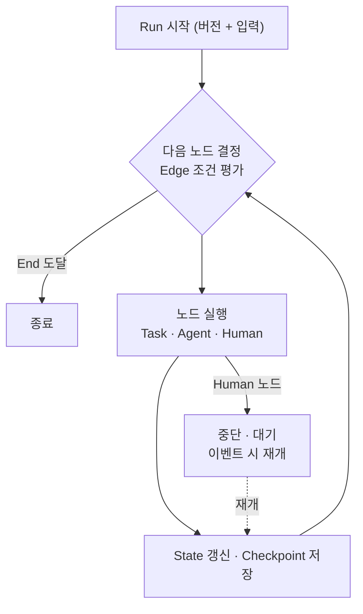
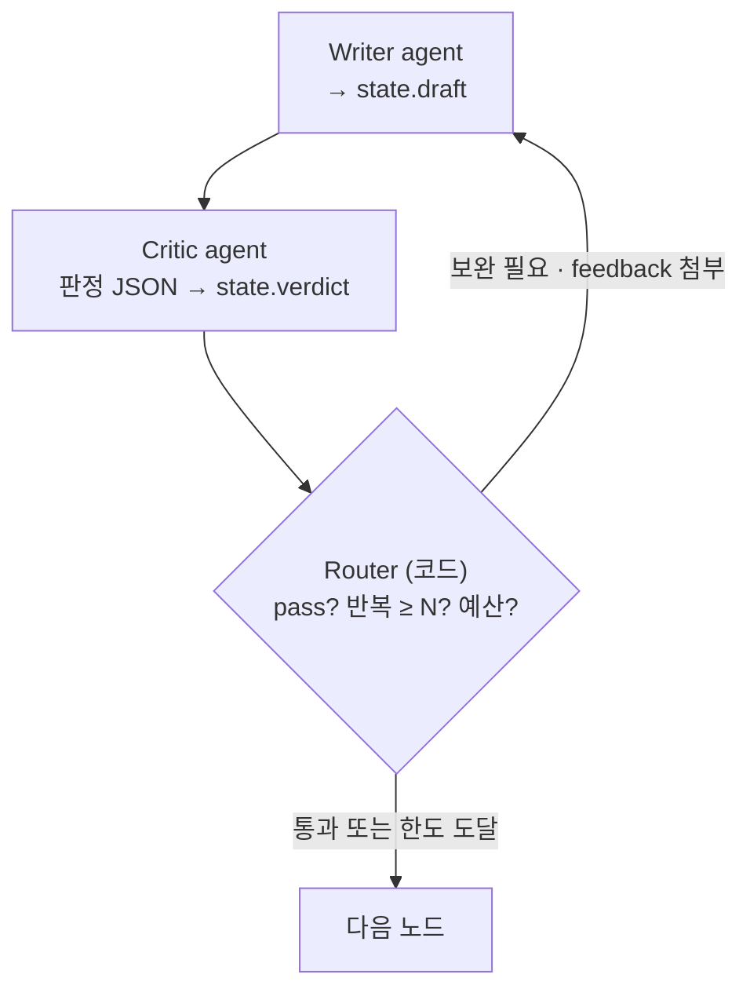

# 5. 실행 루프와 State

## 핵심 개념 5개 (이것만으로 전부 설명)

| 개념 | 의미 |
|---|---|
| Workflow Definition | DSL로 작성, IR로 컴파일된 불변 버전 |
| State | 실행 중 모든 노드가 공유하는 데이터 |
| Node | Task(결정론) · Agent(LLM 루프) · Human(승인) |
| Edge | 다음 노드 결정 규칙 (조건 분기, 루프) |
| Checkpoint | 노드 실행마다 State를 DB에 저장 |

## 실행 루프

- 멀티 Agent 핑퐁 = Agent 노드 사이 Edge 순환, 종료 조건은 Edge에
- HITL = Human 노드에서 Checkpoint 저장 후 멈춤 → 이벤트로 재개
- Durable execution = 매 바퀴 Checkpoint → 죽어도 마지막 저장 지점부터

## 멀티 Agent 협업 (작성자-검토자 루프)

- Agent끼리 직접 대화하지 않는다: **공유 State를 읽고 쓸 뿐**
- 루프 탈출은 **코드가 판단** (Critic은 `{"pass": false, "score": 55, "feedback": "..."}` 같은 구조화 출력만)
- 종료 조건 다중화: 통과, 최대 반복, 예산, 점수 정체, 진동(같은 출력 반복)
- 다른 패턴: Supervisor(handoff Tool로 다음 담당 지정, finish로 종료), Group chat, Handoff, 원격 협업은 A2A

## State 변화 예시 (장애 대응 워크플로)

| 단계 | 노드 | State 변화 | Edge 판단 |
|---|---|---|---|
| 0 | 시작 | run_id, wf_version=3, alert | → fetch_logs |
| 1 | fetch_logs (Task) | + logs_ref(참조만), metric_summary | → analyze |
| 2 | analyze (Agent) | + root_cause, confidence 0.82, tokens | confidence ≥ 0.7 → draft |
| 3 | draft (Agent) | + fix_plan v1, iteration=1 | → review |
| 4 | review (Agent) | + review {pass:false, feedback} | pass=false, 1<3 → draft |
| 5 | draft | fix_plan v2 (덮어씀, 이력은 Checkpoint에), iteration=2 | → review |
| 6 | review | review {pass:true, score 88} | → approve |
| 7 | approve (Human) | status=WAITING, pending{resume_token} | 정지 |
| 8 | approve 재개 | approval {by, decision}, pending=null | 승인 → apply |
| 9 | apply (Task) | action_result, idempotency_key, DONE | 종료 |

## 설계 포인트
- 노드는 선언된 reads만 읽고 writes만 쓴다 (스키마로 강제)
- 큰 데이터는 State에 넣지 않고 참조만 (Claim-check)
- 덮어쓴 값의 이력은 Checkpoint가 보관 → 감사, time-travel
- HITL은 State의 status 필드 하나로 표현
