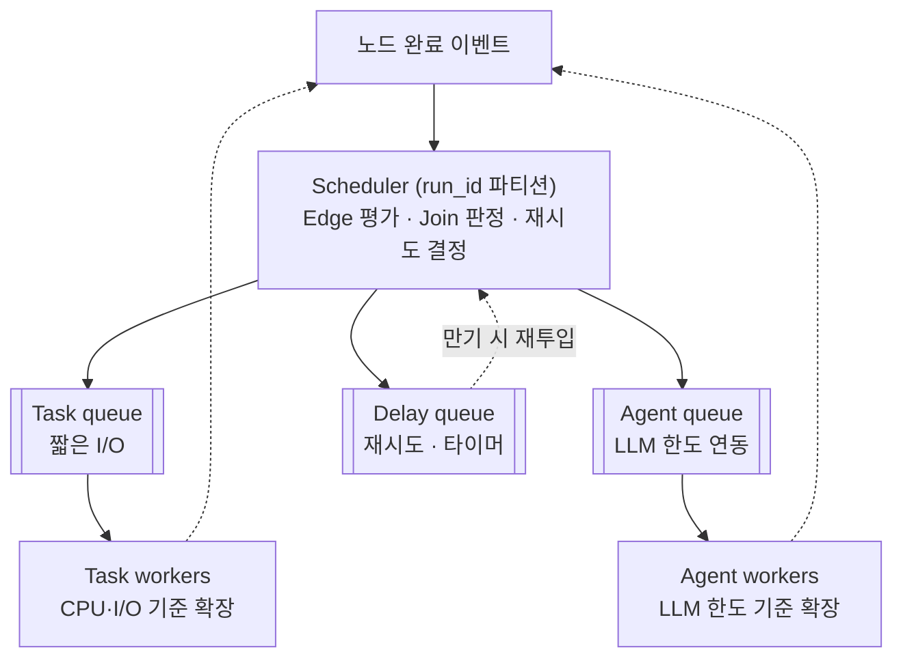

# 7. Scheduler와 Queue

> Scheduler = **결정** (무엇을 실행할지) / Queue = **전달** (유실 없이 Worker에게)



## Scheduler
- **이벤트 기반**: 완료 이벤트가 올 때만 동작 (대기 Run 수천 개여도 자원 거의 0)
- **병렬 분기(fan-out)**: 조건 만족 노드 여러 개를 동시 투입
- **합류(join)**: 합류 노드별 카운터, 0 되면 투입
- **병렬 쓰기 충돌**: DSL에서 필드별 reducer 선언, 없으면 Validator가 중복 쓰기 금지
- **run_id 파티셔닝**: 한 Run의 이벤트는 한 파티션에서 순서대로 → 락 없이 정합성

## Queue 분리 이유
- head-of-line blocking 방지 (긴 Agent가 짧은 Task를 막지 않게)
- 확장 기준 분리 (Task는 CPU·I/O, Agent는 LLM 호출 한도)
- 우선순위 레인 (긴급 · 일반 · 배치)

## 작업 메시지 (State는 넣지 않고 참조만)

```json
{"run_id": "run-7731", "node_id": "analyze", "attempt": 2,
 "checkpoint_id": "cp-0005", "priority": "high",
 "deadline": "2026-10-12T15:30:00Z", "dedupe_key": "run-7731:analyze:2"}
```

## 전달 보장: 최소 한 번 + 중복 제거

| 장치 | 한 줄 |
|---|---|
| 임대 · 가시성 타임아웃 | 꺼낸 작업은 일정 시간 다른 Worker에 안 보임 |
| ack는 Checkpoint 저장 **후** | 순서 바뀌면 작업 유실 |
| dedupe_key | 재전달 시 이미 커밋된 시도면 건너뜀 |
| 펜싱 토큰 | 늦게 깨어난 이전 Worker의 쓰기 거부 |
| DLQ | 재시도 소진 메시지 격리 → 분석 후 재투입 |

## 공정성 · 역압
- 테넌트별 가중 공정 큐잉 + aging (기아 방지)
- LLM GW 포화 → Scheduler가 Agent 투입 감속 → 큐 깊이 임계 초과 시 Run manager가 신규 생성 대기

## 기술 선택

| 선택지 | 장점 | 적합 |
|---|---|---|
| Kafka | 파티션 순서 보장, 대용량 | 완료 이벤트 스트림 |
| RabbitMQ | 우선순위 · 지연 메시지 · ack | 작업 큐 |
| Redis Streams | 가볍고 빠름 | 중소규모 |
| PostgreSQL 큐 | Checkpoint 저장과 작업 등록을 한 트랜잭션으로 | 초기 단계, 운영 단순화 |
