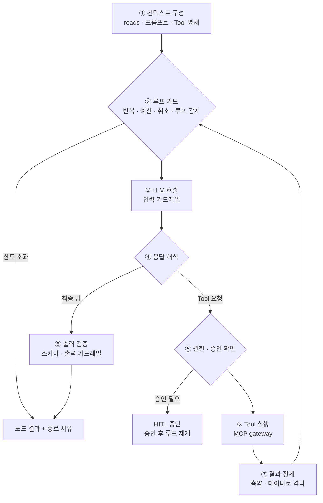
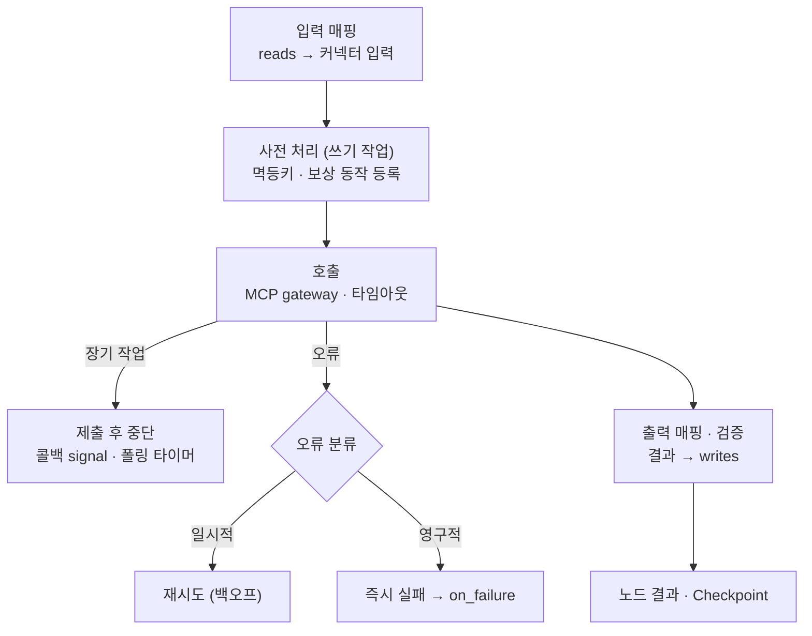
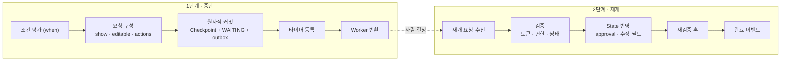

# 8. 실행기 3종 (Task · Agent · Human)

## 비교표 (상세기능 장표용)

| 구분 | Task executor | Agent executor | Human executor |
|---|---|---|---|
| 결정 주체 | 설계자 (IR) | LLM (IR 범위 안에서) | 사람 |
| 결정성 | 결정론 | 비결정론 | 비결정론 |
| 실행 시간 | ms~초 (장기 작업은 중단) | 초~분 | 분~일 (항상 중단) |
| 외부 쓰기 | 주 담당 (멱등키 · 보상) | 승인 필요 Tool만 | 없음 |
| 핵심 통제 | 오류 분류, 멱등성, Saga | 루프 가드, 최소 권한, 결과 정제, 출력 검증 | 원자적 중단, 경쟁 처리, 재검증 |
| 재생 시 | 기록된 결과 재사용 | 반복 단위 기록 재사용 | 기록된 결정 재사용 |

**공통 기반**: 중단·재개 모듈, Checkpoint, Gateway, Trace → 새 노드 유형도 신뢰성 보장을 그대로 상속

---

## Agent executor

> 비결정적인 Agent를 결정론적 틀 안에 가두는 장치가 모여 있는 곳

| 단계 | 핵심 |
|---|---|
| 컨텍스트 구성 | 선언된 reads만, 참조는 필요할 때 Tool로, 컨텍스트 예산 관리(요약·절단) |
| 루프 가드 | 최대 반복, 토큰 예산, 데드라인, 취소 플래그, 같은 Tool·인자 반복 감지 |
| LLM 호출 | Gateway 경유, 마스킹 · 직접 인젝션 탐지, 사용량 누적 |
| 응답 해석 | Tool 요청 / 최종 답 / ask_human / handoff |
| 권한 · 승인 | IR 허용 목록 밖 Tool 거부, `approval: required`면 HITL |
| 반복 단위 기록 | 매 반복 LLM 응답 · Tool 결과 저장 → 루프 중간 재개, 토큰 재지불 없음 |
| 결과 정제 | **간접 프롬프트 인젝션 방어**: "데이터이며 지시 아님"으로 격리 |
| 출력 검증 | 스키마 검증 → 실패 시 오류 붙여 1회 복구 재시도, writes만 반영 |

**최소 권한 원칙**: Agent는 실행 중 IR 설정(Tool, 권한)을 넓힐 수 없다.

### 종료 상태

| status | 의미 | 이후 |
|---|---|---|
| success | 검증 통과 | Edge 평가 |
| limit_exceeded | 반복·예산·데드라인·루프 | on_loop_limit (보통 사람 검토) |
| blocked | 가드레일 차단 | 폴백 없이 HITL/실패 |
| needs_human | ask_human, 승인 필요 Tool | HITL 후 루프 재개 |
| cancelled | 취소 플래그 | Run 취소 |
| failed | 복구 불가 | 재시도 정책 → 에스컬레이션 |

---

## Task executor

> 외부 세계에 영향을 주는 일을 안전하게, 정확히 한 번처럼

| Task 유형 | 예 |
|---|---|
| connector | 티켓 생성, DB 조회, 메일 발송 |
| transform | 형식 변환, 점수 계산 (안전한 표현식 / 샌드박스) |
| wait | 시간 · 이벤트 대기 |
| subworkflow | 공통 워크플로 재사용 |

| 오류 구분 | 예 | 처리 |
|---|---|---|
| 일시적 기술 오류 | 타임아웃, 5xx, 429 | 백오프 재시도 |
| 영구적 기술 오류 | 400, 401/403, 404 | 즉시 실패 |
| **업무 결과** | 재고 없음, 이미 처리됨 | **오류 아님** → State에 기록, Edge로 분기 |

- 멱등키 = `run_id + node_id` (attempt 제외)
- Saga: 짝이 되는 보상 동작(생성 ↔ 종료)을 기록, 취소·실패 시 역순 실행
- 인증정보는 매핑에도 State에도 없음 → Gateway가 Vault에서 주입

---

## Human executor

> 아무것도 실행하지 않는 실행기. 두 번 실행된다 (중단 / 재개).

| 장치 | 한 줄 |
|---|---|
| when 조건 | 저위험은 자동 통과 (decision: auto 기록) |
| Transactional Outbox | Checkpoint · WAITING · 요청 이벤트를 한 트랜잭션 → 유령 대기 방지 |
| 타이머 | Delay queue, 울릴 때 아직 WAITING이면 on_timeout |
| 재개 경쟁 | 타임아웃 vs 승인 동시 도착 → 조건부 변경(CAS), 먼저 온 쪽 승리 |
| 수정 필드 | editable만 허용, 스키마 재검증, 전후 이력 보관 |
| 재검증 훅 | 대기 중 원천 데이터 변경 확인 |

Agent 루프 중간 승인 · 장기 Task도 **같은 중단·재개 모듈** 사용 (기다리는 대상만 다름)
