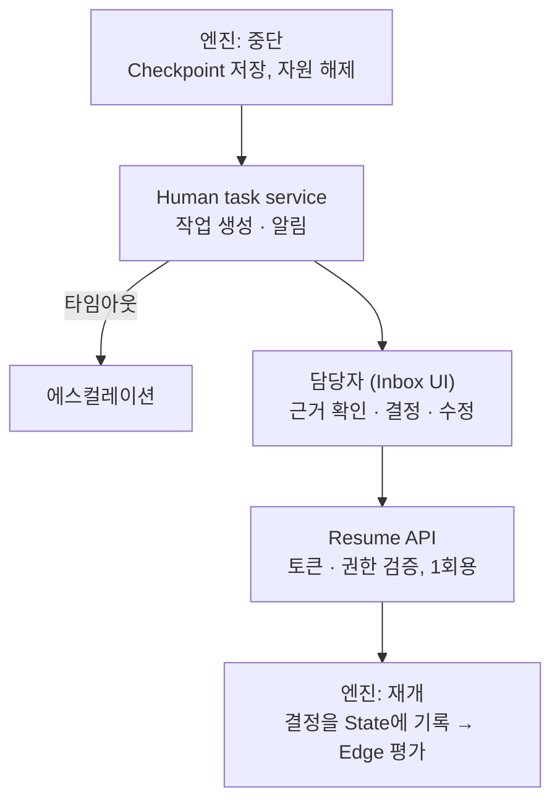

# 9. HITL (Human-in-the-Loop)

## 유형
승인 / 입력 요청 / 검토·수정 / 에스컬레이션

## 정의 시점: HITL을 거는 4가지 위치

| 위치 | 정의 방법 | 기준 |
|---|---|---|
| ① Human 노드 | `type: human` (when, assignee, show, editable, actions, timeout) | 설계자 의도 |
| ② Tool 정책 | Registry에 `approval: required` → Agent 루프 중 실행 직전 가로채기 | 위험 행위 |
| ③ 예외 정책 | `policies: on_failure / on_loop_limit / on_budget_exceeded / on_low_confidence` | 실패 |
| ④ ask_human | Agent에게 주는 특수 Tool | Agent 판단 |

```yaml
- id: approve
  type: human
  kind: approval
  when: "risk_level == 'high' || review.pass == false"
  assignee: {role: ops_lead}
  show: [alert, root_cause, fix_plan, review]
  editable: [fix_plan]
  actions: [approve, reject, edit]
  timeout: 4h
  on_timeout: {escalate_to: {role: ops_manager}}
```

## 실행 시점: 처리 흐름



- 엔진 → HITL: 중단 이벤트 발행 (Outbox) 후 손을 놓음
- HITL → 엔진: Run manager의 resume API
- **관심사 분리**: 엔진은 언제 멈출지만 알고, 사람과의 상호작용은 모른다

## 고찰 포인트
- 대기 중 자원 점유 없음 → Durable execution 필수
- 재개 시 데이터 신선도 → 재검증 단계
- 사람 수정 반영 → editable만, 스키마 재검증
- 형식적 승인(rubber stamping) → 위험도 기반 선별, 판단 근거 제시
- 타임아웃 · 위임 · 중복 재개 방지 (1회용 토큰)
- 사람 결정 이력 → 평가 데이터, "사람 개입률" KPI
