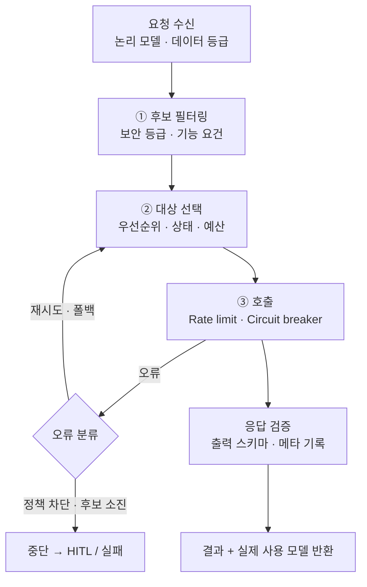

# 10. LLM gateway: 라우팅 · 폴백

> 실행기가 어떤 모델을 쓸지 몰라도 되게 만드는 계층. 노드에는 **논리 모델**만 적는다.



## 라우팅 순서
1. 보안 제약 필터 (기밀 → 내부 모델만, 폴백 시에도 유지)
2. 기능 요건 필터 (Tool 호출, JSON 출력, 컨텍스트 길이)
3. 우선순위 + 동적 상태 (Circuit breaker, 지연, 예산 → 다운그레이드)
4. 가중치 분배 (카나리, A/B)

## 오류별 대응

| 오류 | 대응 |
|---|---|
| 429 한도 초과 | 대기 후 같은 모델, 또는 같은 모델 복제본 |
| 5xx · 타임아웃 | 1~2회 재시도 후 다음 후보 |
| 컨텍스트 초과 | 긴 컨텍스트 모델, 또는 요약 후 재시도 |
| 출력 스키마 불일치 | 오류 붙여 1회 재요청 → 실패 시 폴백 |
| **정책 · 안전 거부** | **폴백 금지** (우회 방지) → HITL |
| 400 잘못된 요청 | 즉시 실패 |

## 핵심 원칙
- **수평 폴백**(같은 등급) vs **강등 폴백**(낮은 등급) 구분
- **폴백은 투명하면 안 된다**: 실제 모델 · degraded 여부를 State/Trace에 기록 → Edge에서 `degraded == true`면 사람 검토 가능
- 폴백 후 출력 검증은 항상, 모델 계열별 프롬프트 변형 허용
- Circuit breaker, 재시도 예산(재시도 폭주 방지), 우선순위별 Rate limit, Scheduler로 역압

```yaml
logical_models:
  reasoning-large:
    requires: [tool_calling, json_output]
    candidates:
      - {endpoint: internal-llm-a, weight: 95}
      - {endpoint: internal-llm-a-canary, weight: 5}
      - {endpoint: external-llm-b, data_class_max: public}
    degrade_to: reasoning-medium
    timeout: {first_token: 10s, total: 120s}
routing_policy:
  data_class: {confidential: [internal-*]}
  on_safety_refusal: halt
  circuit_breaker: {failures: 5, window: 60s, cooldown: 30s}
```
