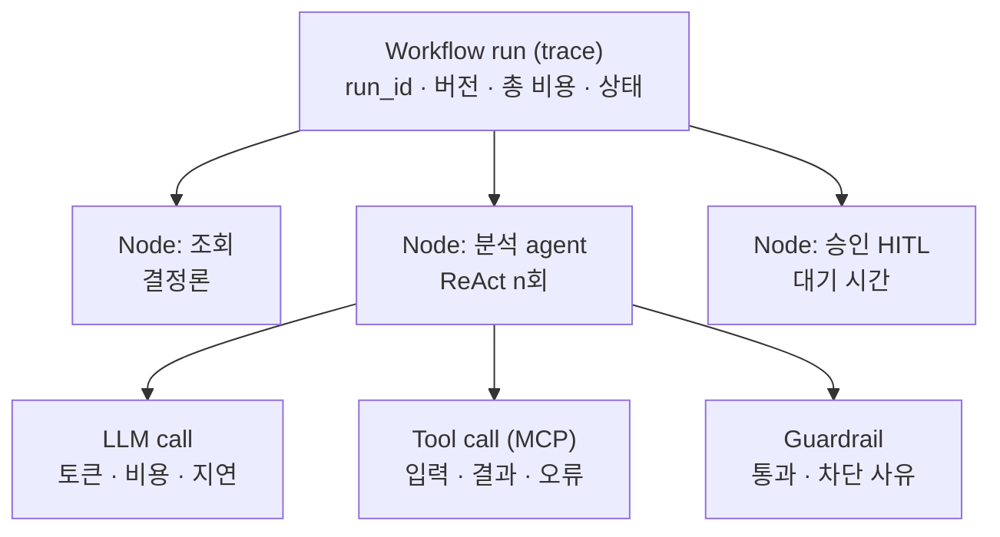
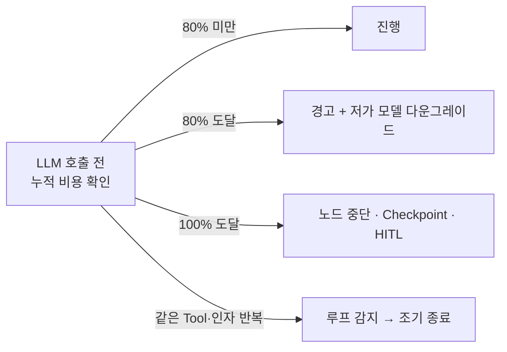

# 11. Observability · Budget guard

> Agent는 실행마다 경로가 다르고, 비용이 토큰에 비례하며, "왜 그렇게 판단했나"까지 추적해야 한다

## Trace / Span 계층

비용은 하위 Span에서 발생해 상위로 roll-up: LLM call → 노드 → Run → 업무 · 부서

## 수집 속성

| 레벨 | 속성 |
|---|---|
| Run | run_id, workflow 버전, 트리거, 상태, 총 시간 · 비용 |
| Node | 노드 유형, 입출력 요약, 재시도 횟수, Checkpoint ID |
| Agent 반복 | iteration, 선택 Tool, 판단 근거 요약, 종료 사유 |
| LLM call | 모델, **프롬프트 버전**, input/output/cached 토큰, TTFT, 비용 |
| Tool call | Tool, MCP 서버, 권한 스코프, 결과, 오류 코드 |
| Guardrail | 정책 ID, 통과/차단, 사유 |

- 표준: OpenTelemetry + GenAI 시맨틱 컨벤션 (invoke_agent, chat, execute_tool) — 아직 Development 상태라 내부 매핑 계층을 둔다
- 엔진 내장 계측 (개발자가 로그 심지 않음)
- 비용 산식: 토큰 × 단가(버전 관리되는 단가 테이블) − 캐시 할인. 온프레미스는 GPU 시간 기반 배분
- Collector에서 PII 마스킹 · Tail-based 샘플링 (오류 · 차단 · 고비용 · 반려는 100% 보관)

## Budget guard (관측이 곧 제어)

## 대시보드
- 운영자: 실행 중 Run, 실패율, 노드 지연 P95, 대기 HITL 수
- 개발자: Run 단위 Span 타임라인, 프롬프트 · 응답 드릴다운
- 관리자: 업무 건당 비용, 예산 대비 누적, 자동화율, 사람 개입률

## Evaluation 연결
HITL 반려 · 낮은 피드백 건 → 골든셋 후보 → 프롬프트 · 모델 · 워크플로 버전 변경 시 회귀 평가
(관측 → 제어 → 개선 순환)
