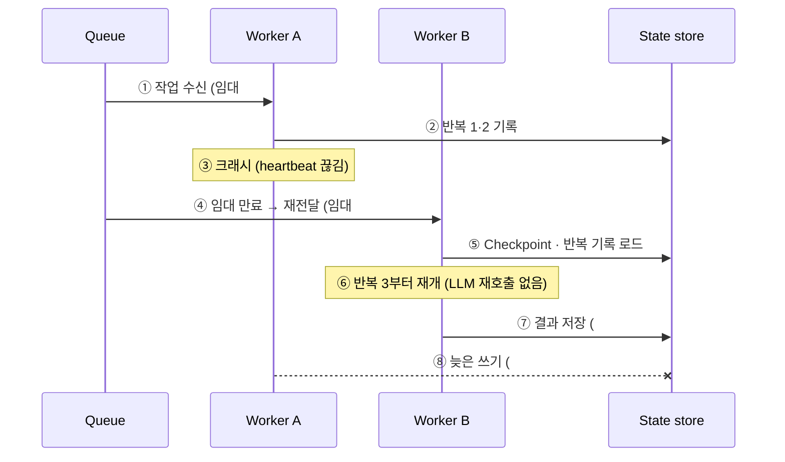

# 12. 세부 메커니즘: 실행 장애 시 작업 인계

## 요구사항 해석 (예: "특정 에이전트가 죽으면 다른 에이전트가 대신 수행")

| 유형 | 상황 | 대응 블록 |
|---|---|---|
| 실행 인프라 장애 | Worker 프로세스·서버 사망 | Queue · Worker · State store |
| 논리적 Agent 실패 | 한도 초과로 포기, 모델 장애 | DSL 실패 정책 · LLM GW 폴백 |

## 인프라 장애 시나리오



## 핵심 장치

| 장치 | 한 줄 |
|---|---|
| 임대 · heartbeat | 응답 끊긴 Worker 감지 |
| 큐 재전달 | 다른 Worker가 인계 |
| 반복 단위 기록 | 끊긴 반복부터 재개, 토큰 재지불 없음 |
| 펜싱 토큰 | 늦은 쓰기 차단 (#7 < #8) |
| 멱등키 | 외부 시스템 중복 방지 |

재사용한 블록: **Queue · Worker · State store** (새 컴포넌트 없음)

## 논리적 실패 대응

```yaml
- id: analyze
  type: agent
  model: reasoning-large        # LLM GW가 모델 장애 시 폴백
  on_failure:
    fallback: analyze_lite       # 대체 Agent 노드
    then: human_review           # 대체도 실패하면 사람에게
```

## Durable execution 두 방식 (배경 지식)
- **스냅샷(Checkpoint)**: 노드마다 전체 State 저장 → LangGraph, Microsoft Agent Framework
- **이벤트 소싱 + 재생(Replay)**: 단계 결과를 이벤트 기록, 재실행 시 기록값 재사용 → Temporal
  - 전제: 흐름 제어 코드는 결정론, LLM·API 호출은 별도 단계(Activity)로 분리
- 공통 함정: 외부 호출 성공 후 기록 전 크래시 → **최소 한 번 + 멱등키 = 사실상 정확히 한 번**
