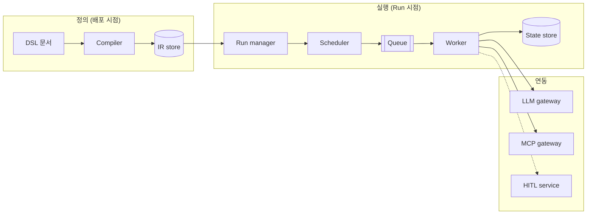

# Agent Workflow Framework

AI Agent의 동작을 Workflow로 정의하고 실행하기 위한 프레임워크 아키텍처 설계 문서입니다.

## 개요

LLM 기반 Agent는 같은 입력에도 다른 경로를 택하는 비결정적 실행 주체입니다. 업무에 적용하려면 Agent의 판단력은 살리되, 흐름 · 비용 · 권한 · 장애 대응은 예측 가능하게 통제되어야 합니다.

이 프레임워크는 다음 원칙을 따릅니다.

> **흐름의 뼈대는 결정론으로, 판단이 필요한 구간만 Agent로, 그 Agent는 엔진이 통제한다.**

- 실행 모델: State · Node · Edge · Checkpoint 기반 그래프 실행 (LangGraph 계열과 동일한 모델)
- 정의 방식: 선언적 DSL을 배포 시점에 IR로 컴파일, 엔진은 검증된 IR만 실행
- 운영 계층: Policy 기반 거버넌스, Gateway 기반 통제, 이벤트 기반 확장 구조

## 설계 불변식

모든 구성요소와 확장 기능은 아래 규칙을 지키며, 요구사항 간 정합성은 이 규칙으로 보장됩니다.

| # | 불변식 | 적용 범위 |
|---|---|---|
| I1 | 실행 중인 Run의 그래프는 바뀌지 않는다 (동적 계획은 자식 Run으로) | Run manager, IR store |
| I2 | 모든 상태는 State store에만 있다 (Worker · Scheduler · SSE gateway는 stateless) | 실행 레이어 |
| I3 | 상태 변경과 이벤트 발행은 한 트랜잭션이다 (Transactional Outbox) | State store |
| I4 | 내부 쓰기는 펜싱 토큰, 외부 쓰기는 멱등키로 보호한다 | Worker, Task executor |
| I5 | 모든 모델 · Tool 호출은 Gateway를 거친다 | LLM gateway, MCP gateway |
| I6 | 비결정 결과(LLM 응답, Tool 결과, 기억 조회, 사람 결정)는 기록하고 재생 시 재사용한다 | 반복 기록, Checkpoint |
| I7 | Compiler 검증을 통과한 정의만 실행된다 (작성 주체와 무관) | Compiler |
| I8 | Agent의 권한 · 예산은 IR이 정한 범위를 넘을 수 없다 (자식 Run 포함) | Agent executor, Policy |
| I9 | Policy의 강제 규칙은 워크플로가 덮어쓸 수 없다 | Compiler |
| I10 | 병렬은 정의(무엇을 병렬로)와 용량(얼마나 동시에)을 분리한다 | DSL, Scheduler, 운영 |

## 아키텍처 요약

## 요구사항

**핵심 요구사항**: 결정론 · Agent 혼합 실행, 제어 흐름 패턴, 외부 시스템 연계, 버전 독립 실행, 선언적 정의, Human-in-the-loop, Agent 통제(토큰 예산 포함), 멀티 Agent 협업, 추적 · 재현, 보안, 장애 시 무손실 재개, 가용성 · 확장성

**확장 요구사항**: 실시간 진행 확인, 모델 장애 · 교체 대응, 변경 품질 사전 검증, 동적 계획, 기억 · 지식 활용

상세 및 정합성 검토: [00 요구사항과 설계 정합성](docs/00-requirements.md)

## 문서

### 아키텍처
- [01 전체 구성](docs/01-layered-architecture.md)
- [02 컴포넌트 상호작용](docs/02-component-interaction.md)
- [03 주요 처리 흐름](docs/03-main-process-flow.md)

### 핵심 설계
- [04 정의: DSL → IR · Policy](docs/04-definition-dsl-ir.md)
- [05 제어 흐름 · 실행 루프 · State](docs/05-control-flow-state.md)
- [06 Run manager](docs/06-run-manager.md)
- [07 Scheduler · Queue](docs/07-scheduler-queue.md)
- [08 실행기 (Task · Agent · Human)](docs/08-executors.md)
- [09 Human-in-the-loop](docs/09-hitl.md)
- [10 장애 시 무손실 재개](docs/10-durability-failover.md)
- [11 가용성 · 확장성 · 병렬 처리](docs/11-availability-scalability.md)
- [12 Agent 통제 · 토큰 예산](docs/12-agent-control-budget.md)
- [13 추적 · 재현 · 보안](docs/13-observability-security.md)
- [14 LLM gateway](docs/14-llm-gateway.md)

### 확장 설계
- [15 실시간 진행 확인](docs/15-realtime-progress.md)
- [16 동적 계획](docs/16-dynamic-planning.md)
- [17 기억 · 지식](docs/17-memory-knowledge.md)
- [18 확장 지점 · 품질 검증](docs/18-extension-points.md)

### 구현 · 참고
- [19 참조 구현: Spring Boot](docs/19-spring-boot-mapping.md)
- [20 관련 오픈소스](docs/20-references.md)

## 표기 규칙

다이어그램에서 보라색은 판단 · 실행 주체, 청록색은 외부 연동 관문, 회색은 저장소 · 인프라를 나타냅니다. 실선은 동기 호출, 점선은 비동기 이벤트입니다.
