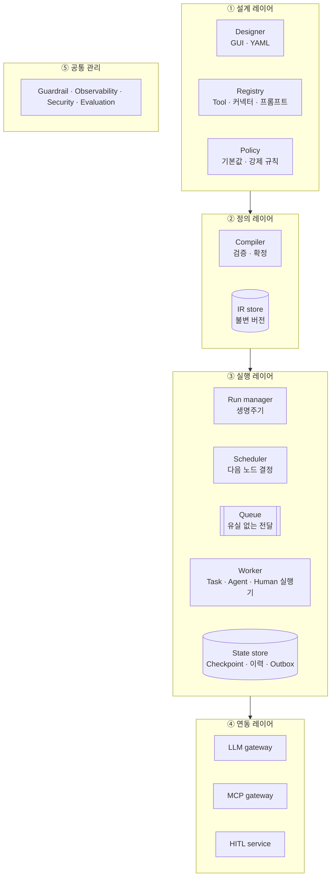

# 01. 전체 구성

> 프레임워크를 구성하는 레이어와 컴포넌트

## 컴포넌트 역할

| 레이어 | 컴포넌트 | 역할 | 키워드 |
|---|---|---|---|
| 설계 | Designer | GUI · YAML로 워크플로 정의 작성 | 선언적 |
| 설계 | Registry | Tool · 커넥터 · 프롬프트 등록 (메타: side_effect, approval) | 부품 |
| 설계 | Policy | 모든 워크플로에 적용되는 기본값 · 강제 규칙 | 상속 |
| 정의 | Compiler | 검증하고 빈칸 채워 IR로 확정 | 배포 전 검증 |
| 정의 | IR store | 확정된 정의를 버전별 보관 | 불변 |
| 실행 | Run manager | 실행 건 생성 · 취소 · 재개 · 조회 | 생명주기 |
| 실행 | Scheduler | 완료 이벤트 받아 Edge 평가, 다음 노드 결정 | 결정 |
| 실행 | Queue | 결정된 작업을 Worker에 유실 없이 전달 | 전달 |
| 실행 | Worker | 노드 실행 (상태 없음, 수평 확장) | stateless |
| 실행 | State store | State · Checkpoint · 반복 기록 · Outbox | 유일한 진실 원천 |
| 연동 | LLM gateway | 모델 라우팅 · 폴백 · 속도 제한 | 통제 지점 |
| 연동 | MCP gateway | Tool 인증 위임 · 권한 · 승인 가로채기 | 통제 지점 |
| 연동 | HITL service | 승인 요청 · 알림 · 타임아웃 · 재개 요청 | 분리 |
| 공통 | Guardrail · Security | 입출력 · 권한 검사, 마스킹 | 보호 |
| 공통 | Observability · Evaluation | Trace · 토큰 비용 · 품질 평가 | 관측 |

## 설계 원칙
1. **통제와 자율성의 균형**: 결정론 뼈대 + 제한된 Agent 구간 (I8)
2. **정의와 실행의 분리**: 검증된 IR만 실행 (I7)
3. **제어 평면과 실행 평면 분리**: 상태는 State store에만 (I2)
4. **단일 통제 지점**: 모델 · Tool 호출은 Gateway 경유 (I5)
5. **비결정 결과의 기록**: 재생 가능한 실행 (I6)
