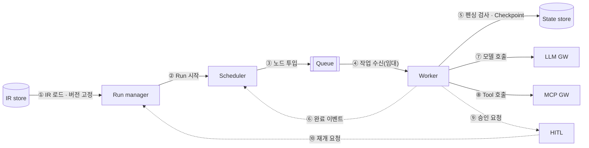

# 02. 컴포넌트 상호작용

> 실행 시점의 컴포넌트 간 연결 (설계 레이어 · Compiler는 배포 전이라 제외)

| 번호 | 연결 | 의미 | 유형 |
|---|---|---|---|
| ① | IR store → Run manager | 배포 버전 로드, Run에 버전 고정 | 동기 |
| ② | Run manager → Scheduler | Run 시작 | 비동기 (Outbox) |
| ③ | Scheduler → Queue | 실행할 노드 작업 투입 | 동기 |
| ④ | Queue → Worker | 작업 수신 (임대 · 펜싱 토큰 발급) | 동기 |
| ⑤ | Worker → State store | 펜싱 검사 + Checkpoint + Outbox 한 트랜잭션, 이후 ack | 동기 |
| ⑥ | Worker → Scheduler | 완료 이벤트 (Outbox 경유) → 다음 노드 결정 | **비동기** |
| ⑦ | Worker → LLM GW | 모델 호출 (Agent) | 동기 |
| ⑧ | Worker → MCP GW | Tool · 커넥터 호출 | 동기 |
| ⑨ | Worker → HITL | 승인 요청 (Outbox), Worker 반환 | **비동기** |
| ⑩ | HITL → Run manager | 승인 후 재개 요청 | **비동기** |

Worker는 상태 없이 실행만 하고, 모든 상태는 State store에 남긴다 (I2).
비동기 연결 덕분에 대량 처리와 수일짜리 대기가 자원 점유 없이 가능하다.
