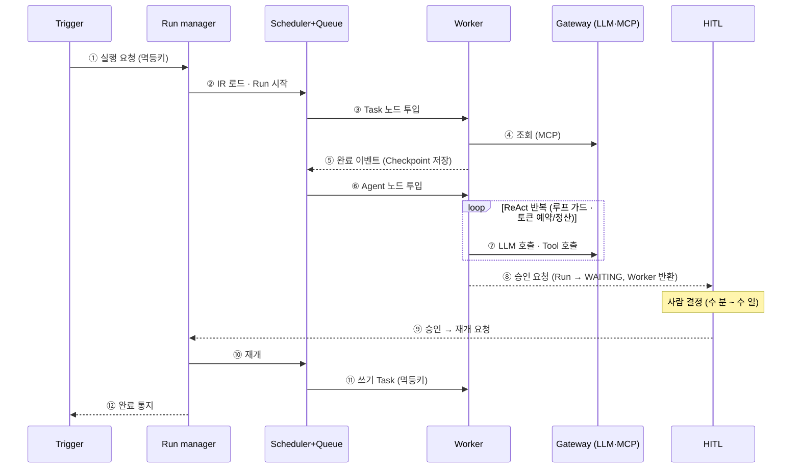

# 03. 주요 처리흐름

> Task 조회 → Agent 판단 → 사람 승인 → 쓰기 → 완료

| 구간 | 단계 | 설명 |
|---|---|---|
| 시작 | ①~② | 멱등 생성, 버전 고정, 초기 Checkpoint |
| Task 노드 | ③~⑤ | 결정론 조회, 완료 이벤트로 다음 결정 |
| Agent 노드 | ⑥~⑦ | 허용 Tool 범위에서 반복, 매 반복 가드 · 예산 검사 |
| 승인 | ⑧~⑩ | 원자적 중단 → 사람 결정 → Checkpoint에서 재개 |
| 완료 | ⑪~⑫ | 쓰기는 결정론 Task + 멱등키 |

**강조점**: ⑧과 ⑨ 사이가 며칠이어도 Worker는 아무것도 붙잡고 있지 않다.
