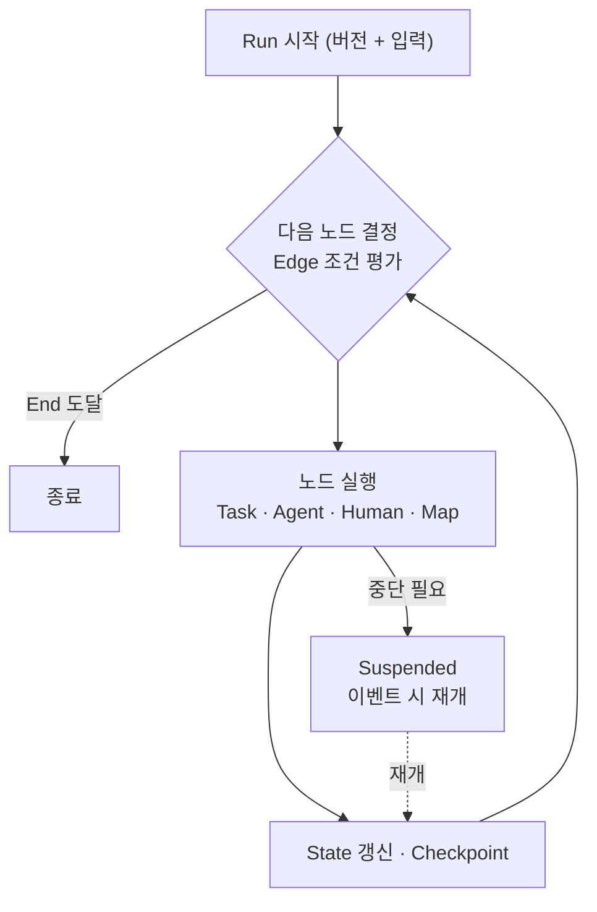
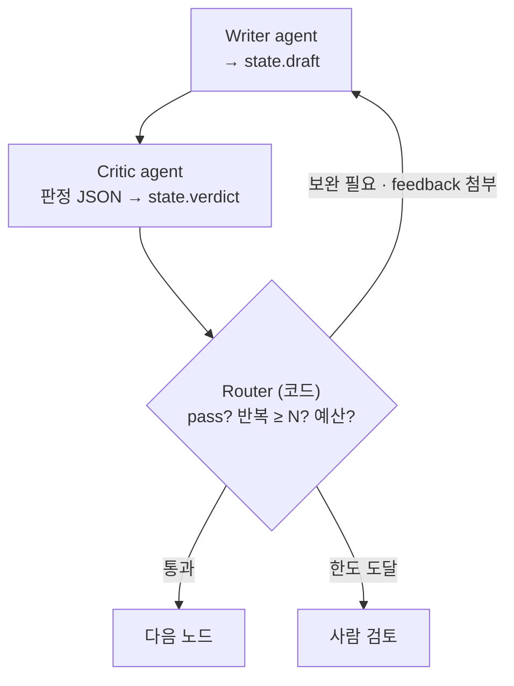

# 05. 제어 흐름 · 실행 루프 · State

> R1 혼합 실행, R2 제어 흐름, R8 멀티 Agent

## 핵심 개념 5개

| 개념 | 의미 |
|---|---|
| Workflow Definition | DSL로 작성, IR로 컴파일된 불변 버전 |
| State | 실행 중 모든 노드가 공유하는 데이터 |
| Node | Task(결정론) · Agent(LLM 루프) · Human(승인) + Map(다중 인스턴스) |
| Edge | 다음 노드 결정 규칙 (조건, 병렬, 반복) |
| Checkpoint | 노드 완료마다 State를 DB에 저장 |

## 제어 흐름 패턴 (R2)

| 패턴 | 의미 | 정의 방법 | 실행 메커니즘 |
|---|---|---|---|
| 순차 | A 다음 B | `a -> b` | Edge 평가 |
| 조건 분기 | 조건에 따라 하나 | `when: "score > 80"` | CEL 조건식 |
| 병렬 분기 · 합류 | A와 B 동시, 둘 다 끝나면 C | 여러 Edge + join | 합류 카운터, reducer |
| 반복 | 조건 만족까지 되풀이 | 순환 Edge + 종료 조건 | Validator가 탈출 조건 검사, 반복 상한 |
| 다중 인스턴스 | 목록 각 항목에 같은 작업 | `type: map` | 창 투입, 항목 슬롯 (→ 11) |
| 대기 | 시간 · 이벤트 · 사람 | `type: wait` / `human` | 중단 · 재개 |
| 하위 워크플로 | 다른 워크플로 호출 | `type: subworkflow` | 자식 Run |

모든 패턴은 **결정론적으로 정의**된다. 실행 시 달라지는 것은 조건 결과와 Map 항목 개수뿐이다.

## 실행 루프

## 멀티 Agent 협업 (R8)

- Agent끼리 직접 대화하지 않는다: **공유 State를 읽고 쓸 뿐**
- 루프 탈출은 **코드가 판단** (Critic은 `{"pass": false, "score": 55, "feedback": "..."}`만 출력)
- 종료 조건 다중화: 통과, 최대 반복, 토큰 예산, 점수 정체, 같은 출력 반복
- 다른 패턴: Supervisor(handoff Tool로 다음 담당 지정), Group chat, 원격 협업은 A2A

## State 변화 예시

| 단계 | 노드 | State 변화 | Edge 판단 |
|---|---|---|---|
| 0 | 시작 | run_id, wf_version=3, alert | → fetch_logs |
| 1 | fetch_logs (Task) | + logs_ref(참조만), metric_summary | → analyze |
| 2 | analyze (Agent) | + root_cause, confidence 0.82 | ≥ 0.7 → draft |
| 3 | draft (Agent) | + fix_plan v1, iteration=1 | → review |
| 4 | review (Agent) | + review {pass:false, feedback} | 1 < 3 → draft |
| 5 | draft | fix_plan v2 (이전 값은 Checkpoint 이력에) | → review |
| 6 | review | review {pass:true, score 88} | → approve |
| 7 | approve (Human) | status=WAITING, pending{resume_token} | 정지 |
| 8 | approve 재개 | approval {by, decision} | 승인 → apply |
| 9 | apply (Task) | action_result, DONE | 종료 |

- 노드는 선언된 reads만 읽고 writes만 쓴다
- 큰 데이터는 참조만 (Claim-check)
- 덮어쓴 값의 이력은 Checkpoint가 보관
