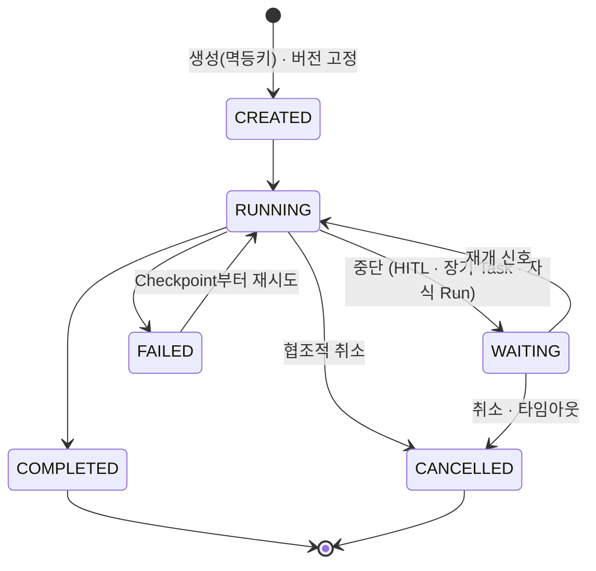

# 06. Run manager

> Run의 생명주기를 소유하는 주체. 외부에서 엔진과 대화하는 유일한 문.

## 역할
1. Run 생성과 버전 고정 (입력 스키마 검증, 초기 Checkpoint)
2. 외부 신호 수신 (취소, HITL 재개, 외부 콜백, 자식 Run 완료) — 충돌 판정을 한 곳에서
3. 상태 조회와 이력 제공
4. 실패 복구와 재실행 (retry, fork)
5. 감시와 통제 (데드라인, 좀비 감지, 전체 동시 Run 상한)

## API

| API | 호출자 | 하는 일 |
|---|---|---|
| `POST /runs` | Trigger, 사용자 | Run 생성 (워크플로 ID, 입력, 멱등키, 데드라인, `wait`) |
| `GET /runs/{id}` | 운영 화면 | 상태, 현재 노드, State 요약 (권한별 마스킹) |
| `GET /runs/{id}/history` | 감사 | Checkpoint · 이벤트 타임라인 |
| `GET /runs/{id}/events` | 클라이언트 | SSE 진행 상황 (확장 E1) |
| `POST /runs/{id}/cancel` | 사용자, 운영자 | 취소 (자식 Run 연쇄 취소) |
| `POST /runs/{id}/resume` | HITL service | 재개 토큰 + 결정 + 수정 필드 |
| `POST /runs/{id}/signal` | 외부 시스템, 자식 Run | 콜백 · 완료 이벤트 전달 |
| `POST /runs/{id}/retry` | 운영자 | 실패 Run을 Checkpoint부터 재실행 |
| `POST /runs/{id}/fork` | 개발자, 감사 | 특정 Checkpoint에서 분기 (재현 · what-if) |

발행 이벤트: `run.started`, `run.waiting`, `run.completed`, `run.failed`, `run.cancelled`

## 메커니즘

| 메커니즘 | 한 줄 |
|---|---|
| 멱등 생성 | 같은 멱등키면 기존 run_id 반환 |
| 버전 고정 · 마이그레이션 | 시작 버전 유지, WAITING 같은 안전 지점에서 graph_hash 호환 시에만 명시적 이전 |
| 낙관적 동시성 제어 | Run 버전 번호로 CAS, 취소와 재개가 동시에 오면 먼저 온 쪽 승리 |
| 협조적 취소 | 플래그만 세우고 안전 지점에서 멈춤, 필요 시 Saga 보상, **자식 Run 연쇄 취소** |
| 좀비 감지 | 임대 갱신 끊기면 Checkpoint 기준 재투입 (→ 10) |
| 입장 제어 | 전체 동시 RUNNING 상한 초과 시 CREATED로 대기 |
| 권한 | 역할 기반 접근 통제 (시작 · 취소 · 조회) |
