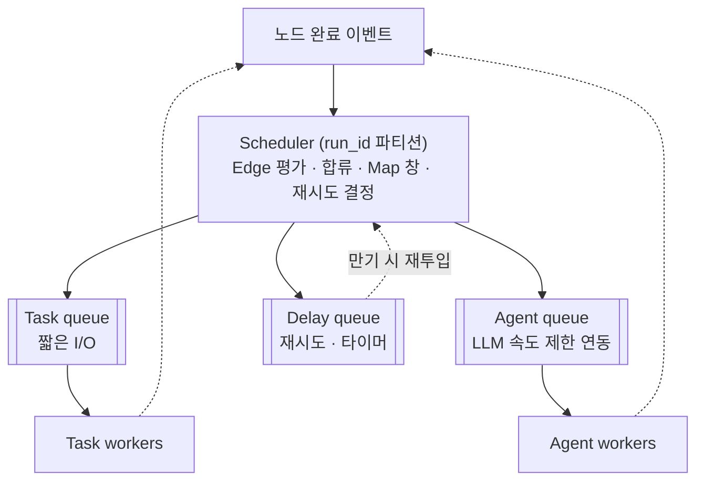

# 07. Scheduler · Queue

> Scheduler = **결정** (무엇을 실행할지) / Queue = **전달** (유실 없이)



## Scheduler
- **이벤트 기반**: 완료 이벤트가 올 때만 동작
- **병렬 분기 · 합류**: 합류 노드별 카운터, 0이 되면 투입
- **Map 창 투입**: 실행 중 항목 수 카운터 ≤ max_concurrency 유지 (→ 11)
- **병렬 쓰기 충돌**: reducer 선언, 없으면 Validator가 금지
- **run_id 파티셔닝**: 한 Run의 이벤트는 한 파티션에서 순서대로 → 락 없이 정합성
- **재시도**: 지수 백오프 + jitter로 Delay queue에

## Queue 분리 이유
- head-of-line blocking 방지 (긴 Agent가 짧은 Task를 막지 않게)
- 확장 기준 분리 (Task는 CPU · I/O, Agent는 LLM 속도 제한)

## 작업 메시지 (State는 참조만)

```json
{"run_id": "run-7731", "node_id": "analyze", "item_index": null, "attempt": 2,
 "checkpoint_id": "cp-0005", "dedupe_key": "run-7731:analyze:-:2"}
```

## 전달 보장: 최소 한 번 + 중복 제거

| 장치 | 한 줄 |
|---|---|
| 임대 · 가시성 타임아웃 | 꺼낸 작업은 일정 시간 다른 Worker에 안 보임 |
| ack는 Checkpoint 저장 **후** | 순서 바뀌면 작업 유실 |
| dedupe_key | 재전달 시 이미 커밋된 시도면 건너뜀 |
| 펜싱 토큰 | 늦게 깨어난 이전 Worker의 쓰기 거부 (→ 10) |
| DLQ | 재시도 소진 메시지 격리 → 분석 후 재투입 |

## 공정성 · 역압
- Run 간 공정성: 한 Run의 대량 Map이 다른 Run을 굶기지 않도록 Run별 가중 공정 큐잉 + aging
- 역압: LLM GW 포화 → Scheduler가 Agent 투입 감속 → 큐 깊이 임계 초과 시 Run manager 입장 제어

## 기술 선택

| 선택지 | 장점 | 적합 |
|---|---|---|
| Kafka | 파티션 순서 보장, 대용량 | 완료 이벤트 스트림 |
| RabbitMQ | 우선순위 · 지연 메시지 · ack | 작업 큐 |
| PostgreSQL 큐 (`SKIP LOCKED`) | Checkpoint와 작업 등록을 한 트랜잭션으로 | 초기 단계, 운영 단순화 |
