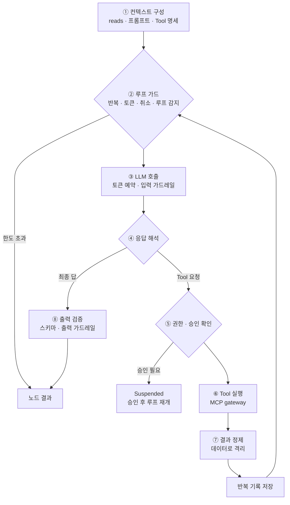
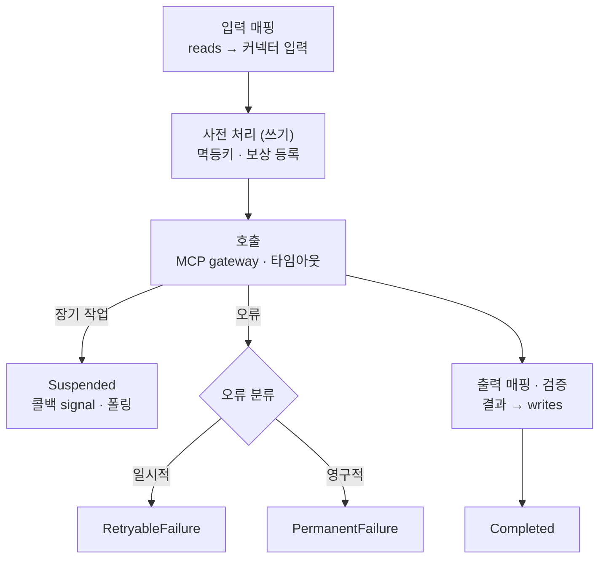
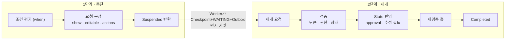

# 08. 실행기 3종 (Task · Agent · Human)

## 비교

| 구분 | Task executor | Agent executor | Human executor |
|---|---|---|---|
| 결정 주체 | 설계자 (IR) | LLM (IR 범위 안에서) | 사람 |
| 결정성 | 결정론 | 비결정론 | 비결정론 |
| 실행 시간 | ms~초 (장기 작업은 중단) | 초~분 | 분~일 (항상 중단) |
| 외부 쓰기 | 주 담당 (멱등키 · 보상) | 승인 필요 Tool만 | 없음 |
| 핵심 통제 | 오류 분류, 멱등성, Saga | 루프 가드, 토큰 예산, 최소 권한, 결과 정제, 출력 검증 | 원자적 중단, 재개 경쟁 처리, 재검증 |
| 재생 시 | 기록된 결과 재사용 | 반복 기록 재사용 | 기록된 결정 재사용 |

**공통 기반**: 중단 · 재개 모듈, Checkpoint, Gateway, Trace
Map 노드는 별도 실행기가 아니라 Scheduler가 항목별로 위 실행기를 반복 투입하는 구조 (→ 11)

## 노드 결과 (문서 · 코드 공통 7종)

| 결과 | 의미 | Scheduler의 다음 행동 |
|---|---|---|
| `Completed` | 정상 완료, writes 반영 | Edge 평가 |
| `Suspended` | 사람 · 외부 · 자식 Run 대기 | Run → WAITING, 재개 이벤트 대기 |
| `RetryableFailure` | 일시적 오류 | 재시도 정책 → Delay queue |
| `PermanentFailure` | 영구 오류 | `on_failure` 정책 (에스컬레이션 · 대체 · 실패) |
| `LimitExceeded` | 반복 · 토큰 · 데드라인 · 루프 감지 | `on_loop_limit` 정책 (보통 사람 검토) |
| `Blocked` | 가드레일 차단 · 안전 거부 | 폴백 없이 HITL 또는 실패 |
| `Cancelled` | 취소 플래그 감지 | Run 취소 처리 |

---

## Agent executor

| 단계 | 핵심 |
|---|---|
| 컨텍스트 구성 | 선언된 reads만, 참조는 필요 시 Tool로, 컨텍스트 예산 관리 (E5 기억 주입 지점) |
| 루프 가드 | 최대 반복, 토큰 예산, 데드라인, 취소 플래그, 같은 Tool · 인자 반복 감지 |
| LLM 호출 | 토큰 예약 → 호출 → 정산 (→ 12), 마스킹 · 직접 인젝션 탐지 |
| 권한 · 승인 | IR 허용 목록 밖 Tool 거부, `approval: required`면 중단 |
| 결과 정제 | 간접 프롬프트 인젝션 방어: "데이터이며 지시 아님"으로 격리 |
| 반복 기록 | LLM 응답 · Tool 결과 · 사용량 저장 (펜싱 토큰 포함) → 루프 중간 재개 |
| 출력 검증 | 스키마 검증 → 1회 복구 재시도, writes만 반영 |

**최소 권한**: Agent는 실행 중 IR의 Tool · 권한 · 예산을 넓힐 수 없다 (I8).

---

## Task executor

| 오류 구분 | 예 | 결과 |
|---|---|---|
| 일시적 기술 오류 | 타임아웃, 5xx, 429 | RetryableFailure |
| 영구적 기술 오류 | 400, 401/403, 404 | PermanentFailure |
| **업무 결과** | 재고 없음, 이미 처리됨 | **Completed** (결과 코드를 State에 기록, Edge로 분기) |

- Task 유형: connector, transform(안전한 표현식), wait, subworkflow
- 멱등키 = `run_id:node_id[:item_index]` (attempt 제외)
- Saga: 짝이 되는 보상 동작을 기록, 취소 · 실패 시 역순 실행
- 인증정보는 매핑에도 State에도 없음 → Gateway가 Vault에서 주입

---

## Human executor

| 장치 | 한 줄 |
|---|---|
| when 조건 | 저위험은 자동 통과 (decision: auto 기록) |
| Transactional Outbox | Checkpoint · WAITING · 요청 이벤트를 한 트랜잭션 → 유령 대기 방지 |
| 타이머 | Delay queue, 울릴 때 아직 WAITING이면 on_timeout |
| 재개 경쟁 | 타임아웃 vs 승인 → 조건부 변경(CAS), 먼저 온 쪽 승리 |
| 수정 필드 | editable만, 스키마 재검증, 전후 이력 보관 |
| 재검증 훅 | 대기 중 원천 데이터 변경 확인 |

Agent 루프 중 승인, 장기 Task, 자식 Run 대기 모두 **같은 Suspended → 재개 경로** 사용
