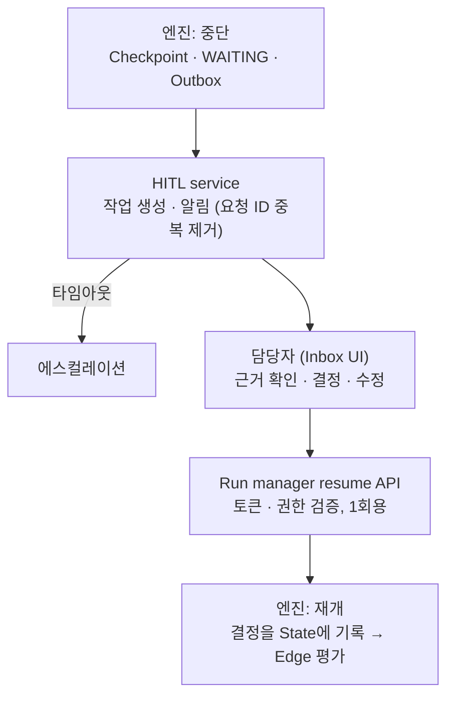

# 09. Human-in-the-loop

> R6 사람 승인 · 검토, 수일 대기

## HITL을 거는 4가지 위치

| 위치 | 정의 방법 | 계기 |
|---|---|---|
| ① Human 노드 | `type: human` | 설계자 의도 |
| ② Tool 정책 | Registry `approval: required` / Policy `write_tools_require_approval` | 위험 행위 |
| ③ 예외 정책 | `on_failure`, `on_loop_limit`, `on_low_confidence` | 실패 |
| ④ ask_human | Agent에게 주는 특수 Tool | Agent 판단 |

```yaml
- id: approve
  type: human
  kind: approval            # approval | input | review_edit
  when: "risk_level == 'high' || review.pass == false"
  assignee: {role: ops_lead}
  show: [alert, root_cause, fix_plan, review]
  editable: [fix_plan]
  actions: [approve, reject, edit]
  timeout: 4h               # Policy 기본값 24h를 덮어씀
  on_timeout: {escalate_to: {role: ops_manager}}
```

## 실행 흐름



- **관심사 분리**: 엔진은 언제 멈출지만 알고, 사람과의 상호작용은 모른다
- 중단 시 미정산 토큰 예약은 해제 (→ 12)

## 고찰 포인트
- 대기 중 자원 점유 없음 → Durable execution 필수
- 재개 시 데이터 신선도 → 재검증 훅
- 형식적 승인(rubber stamping) → 위험도 기반 선별, 판단 근거 제시
- 사람 결정 이력 → 평가 데이터, "사람 개입률" 지표
