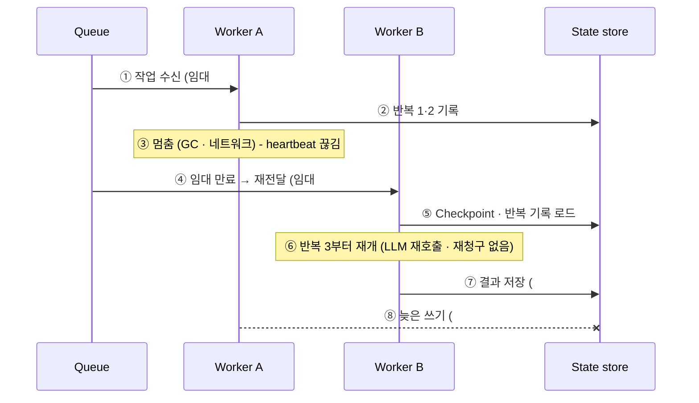

# 10. 장애 시 무손실 재개 (펜싱 · 멱등)

> R11 장애가 발생해도 진행 중인 작업을 유실 없이 이어서 수행

## 해석: 두 가지 장애

| 유형 | 상황 | 대응 |
|---|---|---|
| 인프라 장애 | Worker 프로세스 · 서버 사망, 멈춤 | 임대 만료 → 재전달, 반복 기록 재개, 펜싱 |
| 논리적 실패 | Agent 포기, 모델 장애 | `on_failure: {fallback, then}`, LLM GW 폴백 (→ 14) |

## 식별자 정리

| 식별자 | 구분 대상 | 바뀌는 시점 | 예 |
|---|---|---|---|
| run_id | 실행 건 | 불변 | `run-7731` |
| node_id | 워크플로 단계 | 불변 | `analyze` |
| item_index | Map 항목 | 불변 | `312` |
| attempt | 몇 번째 **시도** | 실패해서 재시도할 때 +1 | 1, 2 |
| fencing token | 몇 번째 **임대** | 임대를 새로 줄 때마다 +1 | 1, 2 |
| dedupe_key | 큐 메시지 중복 | attempt와 함께 | `run-7731:analyze:-:1` |
| idempotency_key | 외부 중복 | **불변** (attempt 제외) | `run-7731:apply` |

Worker가 죽어 다른 Worker가 이어받으면 **attempt는 그대로, token만 증가** (실패가 아니라 담당자 교체).

## 인프라 장애 시나리오



## 펜싱 토큰

**문제**: Worker는 자기가 멈췄었다는 걸 모른다. "임대 확인"과 "쓰기" 사이 틈에 멈추면 낡은 결과를 쓴다.
**해법**: 판단 주체를 쓰는 쪽(Worker)에서 받는 쪽(State store)으로 옮긴다.

1. 임대를 줄 때마다 번호 +1 (단조 증가, 범위: run_id + node_id [+ item_index])
2. Worker는 쓸 때 자기 번호를 함께 보냄
3. State store가 현재 번호와 다르면 원자적으로 거부

```sql
-- 임대 발급
UPDATE node_lease SET token = token + 1, holder = :worker, expires_at = now() + interval '30 seconds'
WHERE run_id = :run AND node_id = :node AND item_index = :idx AND expires_at < now()
RETURNING token;

-- 결과 쓰기 (같은 트랜잭션에서 Checkpoint + Outbox)
UPDATE node_lease SET status = 'DONE'
WHERE run_id = :run AND node_id = :node AND item_index = :idx AND token = :my_token;
-- 0행 → FencedOut, 결과 폐기
```

**펜싱은 내부 저장소를, 멱등키는 외부 시스템을 보호한다.**
외부가 멱등키 미지원 시: 버전 조건부 쓰기(ETag/If-Match) → 그것도 없으면 Saga 보상.

## 따라가 보기: run-7731 (fetch → analyze → apply)

| # | 이벤트 | node | attempt | token | Worker | 결과 |
|---|---|---|---|---|---|---|
| 1 | fetch 투입 · 임대 | fetch | 1 | 1 | W1 | |
| 2 | 조회 완료 쓰기 (token 1 ✓) | fetch | 1 | 1 | W1 | cp-1 → ack |
| 3 | analyze 투입 · 임대 | analyze | 1 | 1 | W2 | |
| 4 | 반복 1·2 기록 | analyze | 1 | 1 | W2 | |
| 5 | **W2 멈춤** → 임대 만료 → 같은 메시지 재전달 | analyze | **1** | | | |
| 6 | W3 임대 | analyze | 1 | **2** | W3 | |
| 7 | 반복 3부터 재개 → 결과 쓰기 (token 2 ✓) | analyze | 1 | 2 | W3 | cp-2 → ack |
| 8 | W2 깨어나 쓰기 시도 | analyze | 1 | 1 | W2 | **거부** (1 ≠ 2) |
| 9 | apply 투입 · 임대 | apply | 1 | 1 | W1 | |
| 10 | 외부 호출 (멱등키 `run-7731:apply`) → 타임아웃 | apply | 1 | 1 | W1 | RetryableFailure |
| 11 | 재시도 투입 · 임대 | apply | **2** | **2** | W4 | |
| 12 | 같은 멱등키로 재호출 → "이미 처리됨" + 원래 결과 | apply | 2 | 2 | W4 | cp-3, 완료 |

## Durable execution 두 방식 (배경)
- **스냅샷(Checkpoint)**: 노드마다 State 저장 — 본 설계 채택 (LangGraph, MS Agent Framework)
- **이벤트 기록 + 재생**: 단계 결과를 기록, 재실행 시 재사용 — Temporal (흐름 코드는 결정론, 부수효과는 Activity로)
- 본 설계는 스냅샷 + Agent 내부 **반복 기록**으로 두 방식의 장점을 결합
- 공통: **최소 한 번 + 멱등 = 사실상 정확히 한 번**
