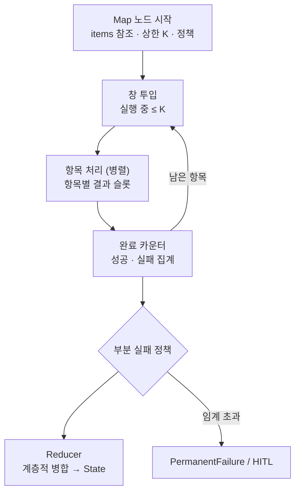

# 11. 가용성 · 확장성 · 병렬 처리

> R12 구성요소 장애에도 서비스 지속, 부하 증가 시 수평 확장 / R2 병렬 정의

## 가용성: 컴포넌트별 장애 매트릭스

| 장애 지점 | 영향 | 대응 |
|---|---|---|
| API (Run manager) | 신규 요청 불가, 실행 중 건은 계속 | 다중 인스턴스 + LB, 멱등 생성으로 재요청 안전 |
| Scheduler | 다음 노드 결정 지연 | run_id 파티션 재할당, 이벤트는 브로커 · Outbox에 보존 |
| Queue 브로커 | 작업 전달 중단 | 클러스터 · 복제, 미전달분은 Outbox에서 재발행 |
| Worker | 진행 중 노드 중단 | 임대 만료 → 재전달, 반복 기록 재개, 펜싱 (→ 10) |
| State store | 전체 진행 중단 | Primary-Standby 복제, 자동 전환, Checkpoint로 무손실 |
| LLM | Agent 노드 실패 | Gateway 폴백, Circuit breaker, 강등 표시 (→ 14) |
| 외부 시스템 | Task 실패 | 오류 분류 · 백오프, 멱등키, Saga, DLQ |
| HITL 서비스 | 승인 요청 지연 | Outbox 재발행, Run은 WAITING으로 안전 대기 |

모든 상태가 State store에 있으므로(I2) 다른 구성요소는 재기동만으로 복구된다. 따라서 고가용성 투자는 State store에 집중한다.

## 병렬: 정의와 용량의 분리 (I10)

| 층 | 질문 | 누가 | 어디서 |
|---|---|---|---|
| 정의 | 무엇을 병렬로 할 수 있나 | 워크플로 설계자 | DSL (병렬 분기, Map) — 결정론 |
| 용량 | 실제 몇 개를 동시에 돌리나 | 운영 | 노드 상한 · 전체 상한 · 인프라 |

| 병렬 유형 | 정해진 것 | 실행 시 달라지는 것 | 일반 워크플로 시스템 예 |
|---|---|---|---|
| 고정 분기 | 병렬 노드 | 없음 | BPMN 병렬 게이트웨이, Step Functions Parallel |
| 다중 인스턴스 (Map) | "각 항목에 이 노드" | 항목 개수만 | BPMN Multi-instance, Step Functions Map, Airflow dynamic task mapping |
| Agent 결정 병렬 | 없음 | 구조 자체 | → 동적 계획(E4)으로 처리, 결국 Compiler로 고정 |

### 동시 실행 3겹 제한 (가장 작은 값이 적용)

| 층 | 정하는 곳 | 목적 |
|---|---|---|
| 노드 | DSL `max_concurrency` (상한일 뿐, Worker 수 아님) | 한 노드의 자원 독점 방지 |
| 플랫폼 | Policy (전체 동시 Run · Run별 동시 작업 상한) | Run 간 공정성 |
| 인프라 | Worker 풀(큐 깊이 기반 오토스케일), LLM 속도 제한 | 시스템 보호 |

Worker 수를 워크플로에 쓰지 않는 이유: Worker 풀은 모든 워크플로가 공유하는 자원.
Agent 특유의 병목: CPU가 아니라 **LLM 속도 제한** → Agent Worker 수는 LLM 한도 기준, Gateway 포화 시 역압.

## Map 노드 (다중 인스턴스)



```yaml
- id: analyze_docs
  type: map
  items: "${doc_refs}"           # 목록 자체가 아닌 참조
  item_as: doc
  body: analyze_one              # 항목마다 실행할 노드 · 하위 워크플로
  max_concurrency: 20            # 상한 K
  batch_size: 10                 # 짧은 작업은 묶음 처리
  on_item_failure: {retry: 2, then: collect}
  failure_threshold: 0.05
  reduce: summarize_findings
  writes: [findings_summary, failed_items]
```

| 장치 | 한 줄 |
|---|---|
| 창 투입 | 한 번에 다 던지지 않고 완료마다 다음 항목 (Scheduler 카운터) |
| 항목 슬롯 | (run, node, index)별 결과 칸 → 쓰기 충돌 없음, Reducer가 한 번에 State 반영 |
| 항목 단위 복구 | 펜싱 · dedupe · 멱등키에 item_index 포함 → 실패 항목만 재처리 |
| 부분 실패 정책 | fail_fast / threshold / collect, 실패 목록은 `failed_items`로 |
| 계층적 병합 | Agent 요약은 20개씩 묶어 요약 → 요약의 요약 (컨텍스트 한도) |
| 토큰 예산 | 항목들이 동시에 써도 예약 · 정산으로 Run 예산 초과 방지 (→ 12) |
| 진행률 | "312 / 1,000 완료" 이벤트 (E1) |

Map 노드는 정의 요소 하나만 추가하며, 신뢰성과 확장성은 기존 엔진 장치를 항목 단위로 그대로 사용한다.
