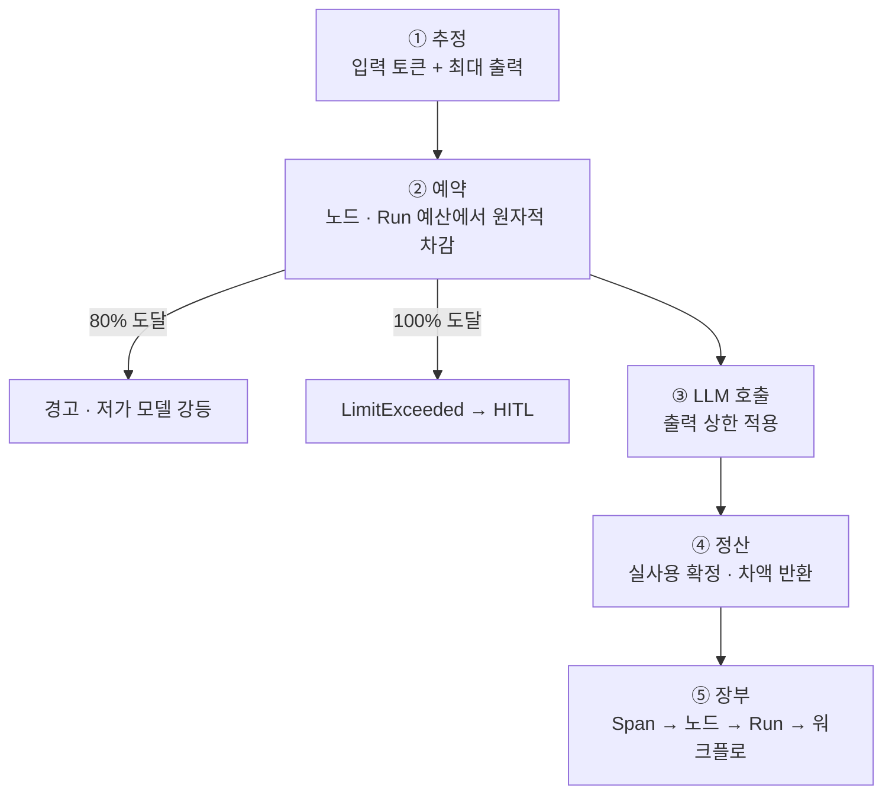

# 12. Agent 통제 · 토큰 예산

> R7 Agent의 무한 반복 · 토큰 폭주 · 권한 남용 통제

## 통제의 세 축

| 축 | 장치 | 위치 |
|---|---|---|
| 실행 통제 | 루프 가드 (최대 반복, 데드라인, 같은 Tool · 인자 반복 감지, 취소) | Agent executor |
| 비용 통제 | 토큰 예산 (예약 · 정산) | Budget guard + LLM GW |
| 권한 통제 | 최소 권한 (IR 허용 Tool만), 쓰기 Tool 승인, 결과 정제 | Agent executor, MCP GW, Policy |

## 속도 제한과 예산 제한은 다르다

| 구분 | 의미 | 성격 | 담당 |
|---|---|---|---|
| 속도 제한 | 분당 토큰 · 요청 수 | 시간이 지나면 다시 채워짐 | LLM gateway |
| 예산 제한 | 노드 · Run 누적 토큰 | 누적, 다시 안 채워짐 | Budget guard |

## 예산 층

| 층 | 예 | 정하는 곳 | 초과 시 |
|---|---|---|---|
| 호출 1회 | 출력 최대 2,000 | IR 노드 설정 | 응답 잘림 |
| 노드 | 2만 토큰 | IR (Policy 기본값) | LimitExceeded |
| Run | 10만 토큰 | Policy 강제 규칙 | Run 중단 → HITL |

## 예약 · 정산 (병렬에서도 초과하지 않게)

**문제**: Map에서 Agent 20개가 동시에 "남은 예산 충분"을 확인하고 호출하면 초과.
**해법**: 신용카드 가승인처럼 먼저 예약하고, 끝나면 실사용으로 정산.



```sql
UPDATE run_budget SET reserved = reserved + :est
WHERE run_id = :run AND (used + reserved + :est) <= max_tokens;   -- 0행이면 거절
```

## 정합성 규칙
- **재생 시 재청구 없음**: 반복 기록에 사용량까지 저장, 재생 구간은 호출 · 차감 안 함 (I6)
- **고아 예약 해제**: 예약에 만료 시간, 임대 만료 시 함께 해제
- **중단 시 해제**: Suspended(HITL 등) 시점에 미정산 예약 해제
- **자식 Run 예산**: 부모 Run 예산에서 떼어 할당 (E4)
- 비용 = 토큰 × 단가(버전 관리 단가표), 내부 모델은 GPU 시간 기반 환산
