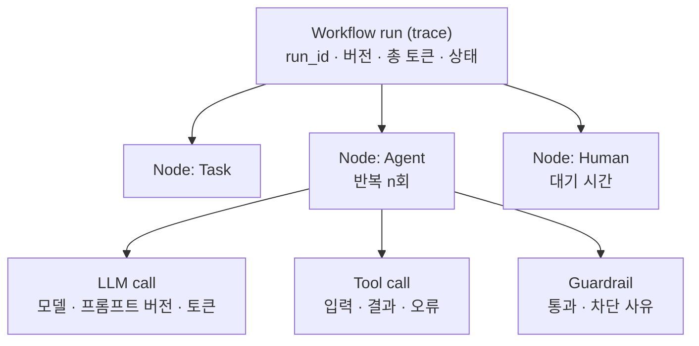

# 13. 추적 · 재현 · 보안

> R9 판단 근거와 이력 추적 · 재현 / R10 민감정보 · 프롬프트 공격 대응

## Trace / Span 계층

| 레벨 | 수집 속성 |
|---|---|
| Run | run_id, workflow 버전 · graph_hash, 상태, 총 시간 · 토큰 |
| Node | 노드 유형, 결과(7종), 재시도, Checkpoint ID |
| Agent 반복 | iteration, 선택 Tool, 판단 근거 요약, 사용 기억 ID(O5) |
| LLM call | 실제 모델, 강등 여부, **프롬프트 버전**, 토큰, 지연 |
| Tool call | Tool, 권한 스코프, 결과, 오류 코드 |
| Guardrail | 정책 ID, 통과/차단, 사유 |

- 표준: OpenTelemetry + GenAI 시맨틱 컨벤션 (invoke_agent, chat, execute_tool), 아직 Development 상태라 내부 매핑 계층
- 엔진 내장 계측, Collector에서 마스킹 · Tail-based 샘플링 (오류 · 차단 · 반려는 100% 보관)

## 재현의 두 가지 의미

| 구분 | 방법 | 용도 |
|---|---|---|
| 기록 재생 (replay) | Checkpoint · 반복 기록의 기록값 재사용 | 감사: "그때 왜 그렇게 판단했나" |
| 분기 재실행 (fork) | 특정 Checkpoint에서 새 Run | 디버깅 · what-if |

재현이 가능한 이유: 비결정 결과(LLM 응답, Tool 결과, 기억 조회, 사람 결정)를 모두 기록 (I6), IR은 불변 · 해시 고정 (I1).

## 보안

| 위협 | 장치 | 위치 |
|---|---|---|
| 민감정보 유출 | 입력 마스킹, 데이터 등급 라우팅 (기밀 → 내부 모델) | Guardrail, LLM GW, Policy |
| 직접 프롬프트 인젝션 | 입력 패턴 탐지 | 입력 가드레일 |
| 간접 프롬프트 인젝션 | Tool 결과 · 기억을 "데이터"로 격리 | Agent executor 결과 정제 |
| 권한 남용 | 최소 권한, 쓰기 승인, 인증정보 비노출 (Vault) | Agent executor, MCP GW |
| 정보 노출 | 조회 · 이벤트 응답 마스킹, RBAC | Run manager, SSE gateway |
| 안전 거부 우회 | 거부 시 폴백 금지 | LLM GW |

**최종 방어선**: 인젝션에 LLM이 넘어가도 허용 목록 밖 Tool은 못 쓰고, 쓰기는 승인을 거친다.
