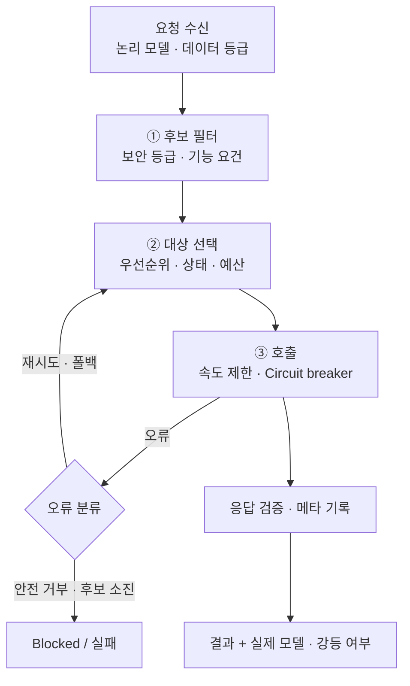

# 14. LLM gateway: 라우팅 · 폴백

> 필수 설계의 통제 지점 + 옵션 O2 (모델 장애 · 교체 대응)

노드에는 **논리 모델**(`reasoning-large`)만 적는다 → 모델 교체 시 Gateway 설정만 변경.



## 라우팅 순서
1. 보안 제약 (Policy 강제: 기밀 → 내부 모델만, **폴백 시에도 유지**)
2. 기능 요건 (Tool 호출, JSON 출력, 컨텍스트 길이)
3. 우선순위 + 상태 (Circuit breaker, 지연, 예산 80% 시 강등)
4. 가중치 (카나리)

## 오류별 대응

| 오류 | 대응 |
|---|---|
| 429 속도 제한 | 대기 후 재시도, 같은 모델 복제본 |
| 5xx · 타임아웃 | 재시도 후 다음 후보 |
| 컨텍스트 초과 | 긴 컨텍스트 모델 또는 요약 후 재시도 |
| 출력 스키마 불일치 | 1회 재요청 → 폴백 |
| **안전 거부** | **폴백 금지** → Blocked |

## 원칙
- 수평 폴백(같은 등급) vs 강등 폴백(낮은 등급)
- **폴백은 투명하면 안 된다**: 실제 모델 · 강등 여부를 State/Trace에 기록 → `degraded == true`면 사람 검토로 분기 가능
- 재생 시에는 기록된 응답 사용 → 폴백 여부와 무관하게 재현 (I6)
- 재시도 예산(폭주 방지), 포화 시 Scheduler로 역압

```yaml
logical_models:
  reasoning-large:
    requires: [tool_calling, json_output]
    candidates:
      - {endpoint: internal-llm-a, weight: 95}
      - {endpoint: internal-llm-a-canary, weight: 5}
      - {endpoint: external-llm-b, data_class_max: public}
    degrade_to: reasoning-medium
    timeout: {first_token: 10s, total: 120s}
routing:
  on_safety_refusal: halt
  circuit_breaker: {failures: 5, window: 60s, cooldown: 30s}
```
