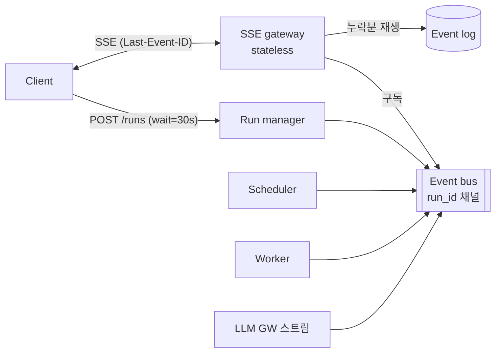

# 15. [확장 E1] 실시간 진행 확인

> 사용자가 "지금 무엇을 하고 있는지" 볼 수 있어야 한다
> 변경 범위: SSE gateway 추가, 기존 Outbox 이벤트 재사용

## 앞단 SSE, 뒷단 동기 · 비동기 모두 가능
- 엔진은 이벤트만 발행, SSE gateway는 구독만 → 엔진 변경 없음
- **동기 대기 후 비동기 전환**: `wait=30s` 안에 끝나면 결과 반환(200), 아니면 run_id 반환(202) → SSE로 전환

## 이벤트 두 종류

| 구분 | 예 | 전달 | 재연결 시 |
|---|---|---|---|
| 상태 이벤트 | run.started, node.completed, run.waiting | Outbox → Event log + bus | Event log에서 재생 |
| 진행 이벤트 | "원인 분석 2/5회차", Tool 호출 중, LLM 토큰, Map 312/1000 | bus만 (최대 한 번) | 유실 허용 |

## 디테일
- 사람이 읽는 문구: DSL `progress_label: "장애 로그 조회 중"`
- 보안: 구독 시 Run 조회 권한 확인, 진행 이벤트에도 마스킹 적용
- 운영: 15초마다 heartbeat 주석으로 프록시 연결 유지, 게이트웨이 수평 확장
