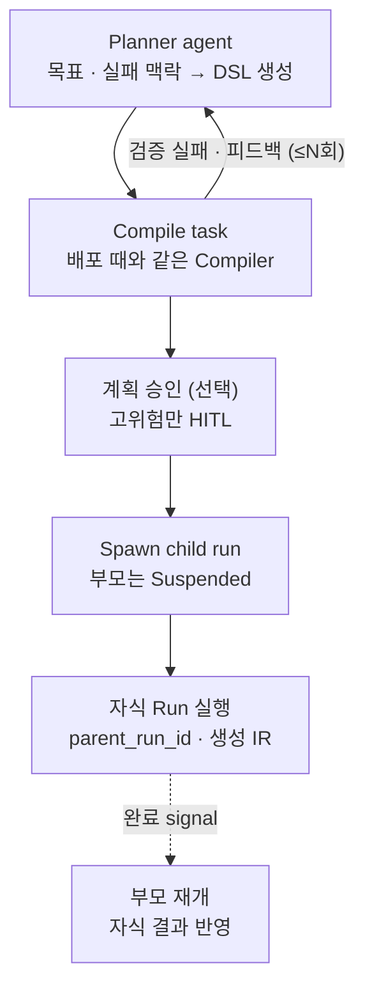

# 16. [옵션 O4] 동적 계획

> Agent가 상황에 따라 처리 절차를 스스로 계획할 수 있어야 한다
> 터치: **Planner 노드 유형 추가** + Compiler · 중단/재개 · Policy 재사용

## 핵심 원칙
**부모 Run의 그래프는 바꾸지 않는다 (I1). 새 계획은 같은 Compiler 검증을 거쳐 자식 Run으로 실행한다 (I7).**

## 판단 시점

| 시점 | 언제 | 정의 |
|---|---|---|
| 실행 전 계획 | 목표만 주어졌을 때 | 첫 노드가 Planner |
| 실행 중 확장 | 하위 절차가 상황마다 다를 때 | 중간 노드가 Planner |
| 재계획 | 계획이 틀렸다고 판단될 때 | `on_failure: replan` → Planner |

## 통제 장치
- 자식의 Tool · 권한 ⊆ 부모 노드 허용 범위 (I8)
- 자식 토큰 예산은 부모 예산에서 할당
- Policy 강제 규칙 적용 → 쓰기 Tool 사용 시 승인 노드 **자동 삽입** (I9)
- 재귀 깊이 제한, 재계획 횟수 제한
- 생성 IR은 `origin: generated, parent_run_id`로 IR store에 저장 → 추적 · 재개 가능
- 부모 취소 시 자식 연쇄 취소
