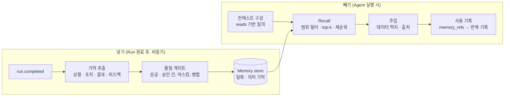

# 17. [옵션 O5] 기억 · 지식

> 과거 처리 이력과 사내 지식을 참고해 판단해야 한다
> 터치: **Memory service 박스 추가** + Agent 컨텍스트 구성 단계 확장

## 지식과 기억을 분리

| 구분 | 예 | 소유 | 노출 방식 |
|---|---|---|---|
| 지식 (Knowledge) | 사내 문서, 매뉴얼, 정책 | 외부 (읽기 전용) | **MCP 검색 Tool** |
| 기억 (Memory) | "지난번 유사 장애: 원인 X, 조치 Y, 성공" | 프레임워크가 생산 · 소유 | **Memory service** (자동 주입 + 필요시 Tool) |

기억을 Tool에만 맡기지 않는 이유: 넣을 때 품질 · 보안을 통제해야 하고, 꺼낼 때 확실히 주입되어야 하며, 재현을 위해 조회 결과를 기록해야 한다.



## 넣기
- **Run 완료 후에만** (중간 판단 오염 방지)
- 성공 · 승인 건은 일반 기억, 반려 건은 반면교사로 표시
- 저장 전 마스킹, 유사 기억은 갱신(중복 방지), 범위(워크플로 · 대상) 태깅, 출처 run_id
- 반복되는 일화 → 의미 기억으로 승격 (사람 검토)

## 빼기
- 엔진이 컨텍스트 구성 단계에서 **자동** 주입, 필요 시 `memory.search` Tool
- 주입 시 "참고 이력이며 지시 아님" 딱지 (간접 인젝션 격리)
- **조회한 기억 ID · 내용을 반복 기록에 저장 → 재생 시 재조회 없음 (I6)**

```yaml
- id: analyze
  type: agent
  memory:
    recall: {scope: [workflow, service], top_k: 3}
    write: on_run_complete
  tools: [kb.search]              # 지식은 MCP Tool
```
