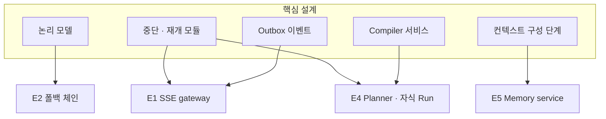

# 18. 확장 지점 · 품질 검증

> 확장 요구사항은 핵심 설계가 제공하는 확장 지점에 기능을 더하는 방식으로 수용한다

## 핵심 설계의 확장 지점

| 확장 지점 | 수용하는 확장 요구사항 |
|---|---|
| 상태 변화마다 이벤트 발행 (Outbox) | E1 실시간 진행 확인: 이벤트 구독만 추가 |
| 노드는 논리 모델만 참조 | E2 모델 교체: Gateway 설정 변경으로 대응 |
| Registry의 Mock Tool, Trace 기록 | E3 품질 검증: 시뮬레이션 · 회귀 평가 |
| Compiler가 독립 서비스 | E4 동적 계획: Planner가 동일 Compiler 호출 |
| 중단 · 재개 공통 모듈 | E4 자식 Run 대기, E1 동기 → 비동기 전환 |
| Agent 실행기의 컨텍스트 구성 단계 분리 | E5 기억: Recall 단계 추가 |

## 확장 요구사항별 변경 범위

| 확장 | 유형 | 추가 요소 | 재사용 요소 |
|---|---|---|---|
| E1 실시간 진행 확인 | 컴포넌트 추가 | SSE gateway, 진행 이벤트 | Outbox, Event log, Run manager |
| E2 모델 장애 · 교체 | 기존 확장 | 폴백 체인 설정 | 논리 모델, Circuit breaker |
| E3 품질 사전 검증 | 기존 확장 | 시뮬레이션 모드, 골든셋 | Compiler, Registry, Trace |
| E4 동적 계획 | 노드 유형 추가 | Planner, 자식 Run 관계 | Compiler, 중단 · 재개, Policy |
| E5 기억 · 지식 | 컴포넌트 추가 | Memory service | MCP Tool, 컨텍스트 구성, 반복 기록 |

## [확장 E3] 품질 사전 검증
- **시뮬레이션 실행**: Registry의 Mock Tool로 외부 부작용 없이 새 버전 실행
- **골든셋 회귀 평가**: HITL 반려 · 낮은 평가 건을 골든셋으로 수집하고, 프롬프트 · 모델 · 워크플로 변경 시 결과 비교
- **카나리 배포**: 새 IR 버전을 일부 Run에만 적용 후 지표 비교
- Trace에 프롬프트 버전 · 모델 · graph_hash가 기록되어 품질 변화의 원인을 분리할 수 있다
